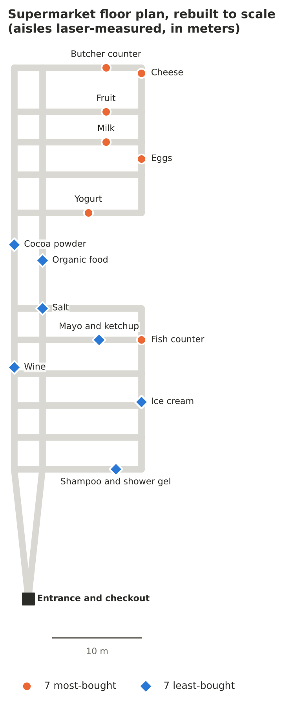
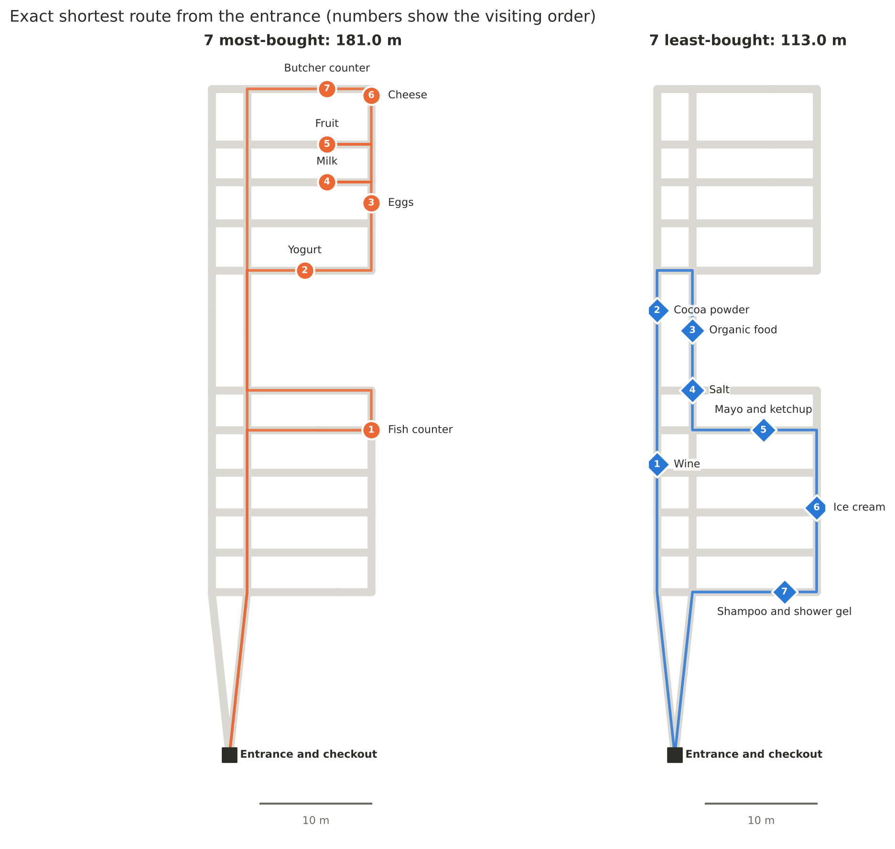
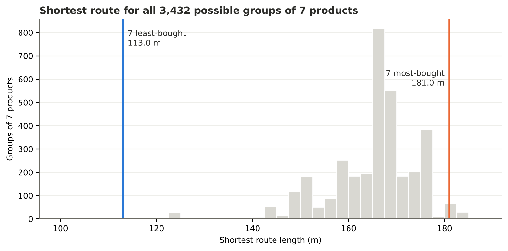
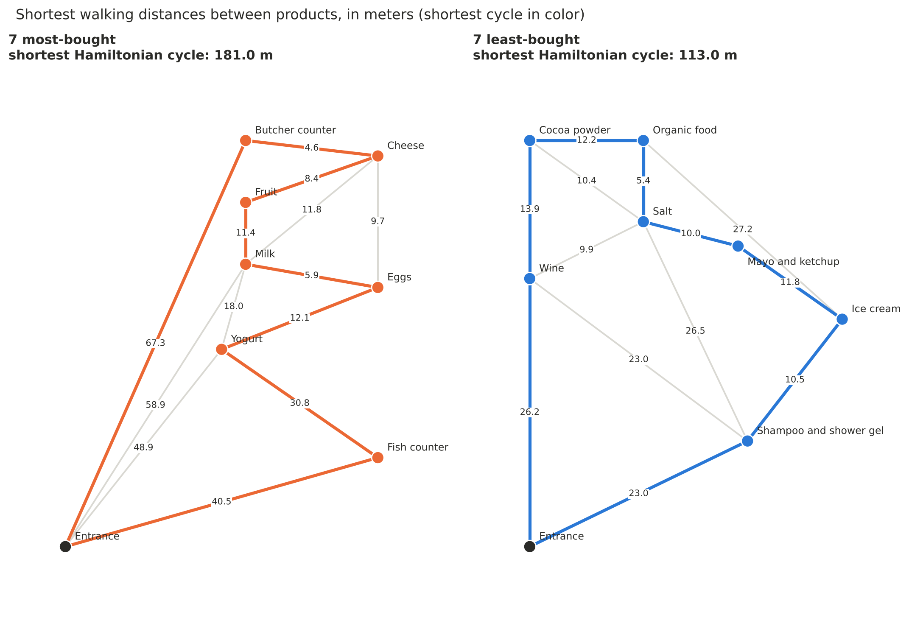

# ¿Por qué la leche siempre está al fondo del supermercado?

*[English version](README.md)*

Estudio de un supermercado real con teoría de grafos: encuesta a 100 personas, plano medido con láser y rutas mínimas exactas calculadas en Python. El código, los datos y las figuras están en inglés; en las figuras, *most-bought* son los más comprados y *least-bought*, los menos comprados.



## De dónde sale esto

De pequeño me llamaba la atención que las chuches siempre estuvieran justo a mi altura. Con los años me enteré de que no era casualidad: los supermercados colocan los productos pensando en cómo nos movemos por la tienda. Una de las ideas más repetidas es que lo imprescindible, como la leche, los huevos o la fruta, se pone al fondo y bien separado, para que tengas que recorrerlo todo y acabes comprando más por el camino.

Cuando tuve que elegir tema para la monografía de Matemáticas del Bachillerato Internacional, pensé que podía comprobarlo de verdad. Hice una encuesta a 100 personas sobre con qué frecuencia compran 29 productos. Después le pedí permiso a la responsable de un Carrefour cerca de mi casa para medir la tienda con un medidor láser, pasillo por pasillo. Con todo eso monté dos grafos, uno con los 7 productos más comprados y otro con los 7 menos comprados, y busqué a mano la ruta más corta para recogerlos todos. La de los más comprados salía bastante más larga.

## Por qué lo he retomado

El proyecto me gustó mucho, pero se había quedado en un PDF con grafos dibujados a mano y cálculos hechos tabla a tabla. Quería ver hasta dónde podía llegar si lo hacía con más rigor. También tenía curiosidad por probar cómo podía ayudarme la IA en un trabajo así.

Lo he rehecho en Python con ayuda de Claude, un asistente de IA. La encuesta, las medidas, la pregunta y la forma de plantear el estudio son mías y vienen de la monografía. La IA me ayudó en las partes que más me costaban o que no había podido hacer: reconstruir el plano a escala a partir de mis notas, escribir y probar el código, encontrar errores en mis cálculos y añadir una prueba que no estaba en el trabajo original, la comparación con el azar que explico abajo.

Al pasarlo todo a código salieron algunos fallos de la monografía. Los cuento más abajo. Ninguno cambia la conclusión.

## Qué he hecho

Primero convertí cada respuesta de la encuesta en compras al mes ("una vez a la semana" cuenta como 4, "dos veces al mes" como 2, y así hasta "nunca", que es 0). La fruta sale la primera con 3,71 compras al mes y la sal la última con 0,47. Me quedé con los 7 de arriba y los 7 de abajo. El azúcar lo dejé fuera porque está en el mismo lineal que la sal.

Luego convertí el plano en un grafo: cada cruce de pasillos y cada producto es un nodo, y cada tramo de pasillo es una arista con sus metros. Con el algoritmo de Dijkstra saco la distancia andando entre cualquier par de productos.

La ruta que sale de la entrada, pasa por los 7 productos y vuelve a la caja es un ciclo hamiltoniano mínimo, el famoso problema del viajante. En la monografía lo resolví con el algoritmo del vecino más cercano, que da una buena solución pero no garantiza la mejor. Ahora lo resuelvo de forma exacta con el algoritmo de Held-Karp, y un test comprueba que da lo mismo que probar los 5.040 órdenes posibles.

Lo último es lo que más me gusta. En la monografía solo comparaba un grupo con otro, y eso no demuestra mucho. Ahora calculo la ruta mínima de los 3.432 grupos de 7 productos que se pueden formar con los 14 que medí. Así veo si los más comprados están más separados de lo que saldría por puro azar.

## Lo que sale



La ruta por los 7 más comprados mide 181,0 m y la de los 7 menos comprados, 113,0 m. Es un 60 % más.



De los 3.432 grupos posibles, solo otros 69 (el 2 %) obligan a andar lo mismo o más que los más comprados. Y solo otros 7 tienen una ruta igual de corta o más que la de los menos comprados.

Hay un matiz que no vi en la monografía. Casi cualquier grupo de 7 productos sale largo, porque casi siempre incluye algo del fondo de la tienda: la mediana es 167 m. Lo que más llama la atención no es tanto que lo más comprado esté lejos, sino que lo menos comprado está todo junto cerca de la entrada.



Estos son los dos grafos de la monografía, con las distancias recalculadas sobre el plano. Una cosa que me alegró comprobar es que mi vecino más cercano sí había llegado a la ruta óptima en los dos casos, aunque mi argumento de por qué lo hacía no era correcto.

## Errores que encontré en la monografía

- Puse que la ruta era un 163 % más larga, y es un 63 %: confundí "1,63 veces" con "163 % más".
- Calculé la distancia de la entrada a la leche y a la carnicería por el pasillo izquierdo, pero por el central se llega antes (58,9 y 67,3 m en vez de 62,1 y 70,5). Por eso la ruta de los más comprados baja de 184,2 a 181,0 m. La de los menos comprados se queda en 113 m, como en la monografía.
- La distancia de helados a biofood la copié mal: puse 21,8 m, que es la de helados a sal. La buena es 27,2 m.
- De yogures a leche puse 20,4 m, pero pasando por los huevos son 18,0 m.
- Dije que el vecino más cercano da siempre el ciclo mínimo porque elige el camino más corto en cada paso. No es verdad en general; por eso ahora calculo el óptimo exacto.
- En la hoja de cálculo de la encuesta escribí 0,0162 donde era 0,162 (en los cereales). No cambia nada del resultado.

Las otras 22 distancias que calculé a mano coinciden con el plano al decímetro, y hay un test que lo comprueba.

## Lo que este estudio no demuestra

Es un solo supermercado, así que no puedo decir que todos hagan lo mismo. La encuesta la respondió gente de mi entorno, no una muestra representativa. La distancia de la entrada al pasillo central no la medí, la deduje de mis propios cálculos; si solo se entra por el izquierdo, las rutas miden 187,4 y 116,2 m y la conclusión es la misma. Y que lo más comprado esté lejos encaja con la idea de que es una estrategia comercial, pero también puede tener otras razones, como dónde están las cámaras frigoríficas o la zona de carga.

## Para ejecutarlo

```bash
pip install -r requirements.txt
python main.py          # saca los resultados y vuelve a generar las figuras
python -m pytest        # comprueba que el código reproduce la monografía
```

Los datos están en `data/`, el código en `src/`, los tests en `tests/` y las figuras en `figures/`.
